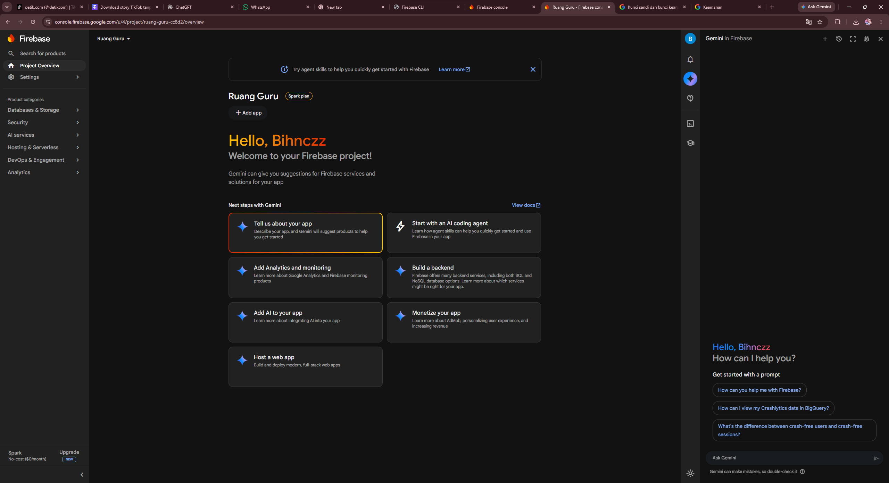

# PROJECT PROMPT — ENGLISH TUTORING APP

## 1. Project Overview

Buat aplikasi mobile Android menggunakan Flutter dengan konsep platform les bahasa Inggris seperti Ruangguru, dengan sistem registrasi siswa dan guru yang terpisah.

Untuk tahap pertama, fokus pada:
1. Welcome / Splash Screen.
2. Login.
3. Registrasi siswa.
4. Registrasi guru.
5. Upload dokumen persyaratan guru.
6. Verifikasi pendaftaran guru oleh admin.
7. Dashboard siswa.
8. Dashboard guru.
9. Form Daily Lesson Report.
10. Riwayat Daily Report.

Jangan langsung membangun seluruh fitur platform. Buat fondasi aplikasi yang rapi, berfungsi, aman, dan mudah dikembangkan ke tahap berikutnya.

## 2. Technology Stack

- Flutter dan Dart.
- Material 3.
- Riverpod untuk state management.
- GoRouter untuk navigasi.
- Firebase Authentication untuk autentikasi.
- Cloud Firestore untuk database.
- Firebase Storage untuk dokumen PDF.
- Struktur kode modular dan scalable.
- Android sebagai platform target awal.

Gunakan package versi stabil yang kompatibel satu sama lain. Periksa versi Flutter dan konfigurasi proyek sebelum menambahkan dependency.

## 3. UI/UX Design

Buat desain aplikasi dengan karakteristik berikut:
- Modern, clean, premium, dan profesional.
- Tema pendidikan bahasa Inggris.
- Warna utama biru, putih, dan aksen cyan.
- Card dengan rounded corners.
- Typography yang mudah dibaca.
- Form dengan label jelas dan validasi langsung.
- Tombol utama yang konsisten.
- Loading indicator saat proses berlangsung.
- Error state dan success notification.
- Empty state jika belum ada data.
- Responsive untuk berbagai ukuran layar Android.
- Mendukung keyboard, scroll, dan layar kecil.

Hindari UI yang terlalu ramai. Prioritaskan pengalaman pengguna yang sederhana dan intuitif.

## 4. Application Flow

Saat aplikasi dibuka:

1. Tampilkan splash screen.
2. Periksa status autentikasi pengguna.
3. Jika belum login, tampilkan halaman Welcome dengan pilihan Login, Daftar sebagai Siswa, dan Daftar sebagai Guru.
4. Jika sudah login, arahkan pengguna berdasarkan role dan status akunnya.
5. Siswa diarahkan ke Student Dashboard.
6. Guru yang sudah disetujui diarahkan ke Teacher Dashboard.
7. Guru yang masih menunggu verifikasi diarahkan ke halaman Application Status.
8. Guru yang ditolak dapat melihat status dan alasan penolakan jika tersedia.

Role pengguna tidak boleh ditentukan hanya dari pilihan atau data yang dikirim oleh aplikasi. Validasi role dan hak akses harus dilakukan di backend.

## 5. Login

Buat halaman login dengan:
- Email.
- Password.
- Tombol tampil/sembunyikan password.
- Remember session melalui mekanisme autentikasi yang aman.
- Tombol Login.
- Link Lupa Password.
- Link Registrasi Siswa.
- Link Registrasi Guru.
- Validasi input.
- Loading state.
- Pesan error yang mudah dipahami.

Gunakan Firebase Authentication. Email digunakan sebagai kredensial login pada versi awal. Nomor WhatsApp disimpan sebagai data kontak dan tidak otomatis dianggap sebagai metode login terverifikasi.

## 6. Student Registration

Buat halaman registrasi siswa dengan field berikut:

1. Nama lengkap.
2. Tanggal lahir.
3. Usia, dihitung otomatis dari tanggal lahir.
4. Nomor WhatsApp.
5. Email.
6. Alamat atau tempat tinggal.
7. Area lokasi les yang diinginkan.
8. Pernah mengikuti les bahasa Inggris atau belum, pilihan Ya/Tidak.
9. Level atau program yang diminati.
10. Password.
11. Konfirmasi password.
12. Persetujuan kebijakan privasi dan ketentuan layanan.

Persyaratan:
- Field wajib diberi validasi.
- Email harus valid.
- Password dan konfirmasi password harus cocok.
- Nomor WhatsApp menggunakan validasi yang sesuai.
- Area lokasi les dan program menggunakan pilihan yang dapat dikonfigurasi.
- Tanggal lahir digunakan untuk menghitung usia.
- Tampilkan ringkasan atau konfirmasi setelah registrasi berhasil.
- Data profil siswa disimpan ke Firestore setelah autentikasi berhasil.
- Jangan membuat akun ganda ketika pengguna mengulangi proses registrasi.

## 7. Teacher Registration

Buat halaman registrasi guru dengan field:

1. Nama lengkap.
2. NIK, tepat 16 digit angka.
3. Tanggal lahir.
4. Usia dihitung otomatis.
5. Nomor WhatsApp.
6. Email.
7. Pendidikan terakhir.
8. Latar belakang pendidikan atau jurusan.
9. Level bahasa Inggris.
10. Upload dokumen PDF hasil tes bahasa Inggris.
11. Alamat lengkap.
12. Area atau lokasi kesediaan mengajar.
13. Password.
14. Konfirmasi password.
15. Persetujuan kebijakan privasi dan ketentuan layanan.

Validasi wajib:
- Usia maksimal 35 tahun saat mendaftar.
- NIK harus terdiri dari 16 digit.
- Level bahasa Inggris minimal B2.
- Dokumen hasil tes bahasa Inggris wajib dilampirkan.
- Terima PDF hasil tes yang relevan, termasuk hasil tes gratis British Council yang dapat diverifikasi sesuai ketentuan program.
- Batasi ukuran file dan validasi tipe dokumen di sisi server.
- Tampilkan nama file, ukuran file, dan status upload.
- Berikan opsi mengganti dokumen sebelum formulir dikirim.
- Lindungi NIK, alamat, dan dokumen guru dari akses publik.

Jangan menganggap hasil tes gratis otomatis setara dengan sertifikasi resmi internasional. Simpan jenis tes dan dokumen untuk diperiksa admin.

Setelah formulir berhasil dikirim:
- Buat akun guru.
- Simpan profil guru.
- Simpan dokumen secara privat.
- Tetapkan applicationStatus = pending.
- Tampilkan halaman "Pendaftaran Sedang Ditinjau".
- Guru belum boleh membuat atau mengelola sesi les sampai disetujui admin.

Status pendaftaran:
- pending
- approved
- rejected

Admin harus dapat melihat data pendaftaran, meninjau dokumen, menyetujui atau menolak aplikasi, serta memasukkan alasan penolakan.

## 8. Student Dashboard

Untuk versi awal, buat dashboard sederhana yang menampilkan:
- Sapaan dan nama siswa.
- Ringkasan profil.
- Program atau level yang diminati.
- Area lokasi les pilihan.
- Status profil.
- Placeholder untuk placement test.
- Placeholder untuk jadwal les dan perkembangan belajar.
- Tombol edit profil.
- Menu pengaturan dan logout.

Placement test belum perlu dibuat. Siapkan struktur agar nanti dapat ditambahkan soal, pilihan jawaban, penilaian otomatis, skor, dan rekomendasi level.

## 9. Teacher Dashboard

Buat dashboard guru yang menampilkan:
- Sapaan dan nama guru.
- Status verifikasi.
- Ringkasan profil.
- Lokasi kesediaan mengajar.
- Tombol Daily Report.
- Riwayat Daily Report.
- Tombol edit profil sesuai izin.
- Menu pengaturan dan logout.

Guru dengan status pending atau rejected tidak boleh mengakses fitur yang khusus untuk guru approved.

## 10. Daily Lesson Report

Buat form Daily Report dengan field:

1. Tanggal les.
2. Lokasi pertemuan.
3. Waktu mulai.
4. Waktu selesai.
5. Pertemuan ke berapa.
6. Materi yang diajarkan.
7. Komentar selama pertemuan.
8. Notes tambahan, opsional.

Sediakan pemilihan siswa dan sesi les yang relevan. Jika belum ada sistem jadwal, buat struktur sementara agar relasi siswa-guru dapat ditambahkan kemudian.

Validasi:
- Tanggal wajib diisi.
- Lokasi wajib diisi.
- Waktu mulai dan selesai wajib diisi.
- Waktu selesai harus setelah waktu mulai.
- Nomor pertemuan harus valid.
- Materi wajib diisi.
- Komentar wajib diisi.
- Notes tidak wajib.
- Guru hanya boleh membuat laporan untuk sesi yang menjadi kewenangannya.

Fitur:
- Simpan laporan.
- Tampilkan loading dan status penyimpanan.
- Cegah submit berulang yang membuat duplikasi.
- Tampilkan konfirmasi setelah berhasil.
- Riwayat laporan dengan filter tanggal.
- Detail laporan.
- Edit laporan sesuai kebijakan aplikasi.
- Simpan createdAt dan updatedAt.
- Tampilkan nama guru dan siswa terkait.
- Persiapkan fitur export PDF untuk tahap berikutnya.

Gunakan server timestamp jika memungkinkan. Jangan mengandalkan ID guru atau siswa yang dikirim dari klien tanpa verifikasi backend.

## 11. Database Structure

Rancang struktur database yang konsisten, minimal meliputi:

### users
- uid
- email
- role
- accountStatus
- createdAt
- updatedAt

### studentProfiles
- uid
- fullName
- birthDate
- whatsapp
- email
- address
- preferredTeachingArea
- hasEnglishLearningExperience
- preferredProgram
- createdAt
- updatedAt

### teacherProfiles
- uid
- fullName
- nik
- birthDate
- whatsapp
- email
- education
- educationBackground
- englishLevel
- englishTestDocumentPath
- address
- availableTeachingAreas
- applicationStatus
- rejectionReason
- reviewedAt
- createdAt
- updatedAt

### lessonReports
- reportId
- teacherUid
- studentUid
- lessonDate
- meetingLocation
- startTime
- endTime
- meetingNumber
- materialsCovered
- sessionComments
- additionalNotes
- createdAt
- updatedAt

Tambahkan validasi dan indeks Firestore yang diperlukan. Sesuaikan struktur berdasarkan implementasi akhir dan hindari menyimpan data yang tidak diperlukan.

## 12. Security Requirements

- Terapkan Firebase Authentication.
- Terapkan Firestore Security Rules.
- Terapkan Storage Security Rules.
- Pengguna hanya dapat membaca dan mengubah data yang diizinkan.
- Guru hanya dapat mengakses laporan dan sesi yang menjadi kewenangannya.
- Siswa hanya dapat mengakses profil dan laporan yang memang diizinkan untuk dilihatnya.
- Hanya admin yang dapat memverifikasi pendaftaran guru.
- Status approved tidak boleh diubah oleh pengguna melalui aplikasi.
- Dokumen NIK dan hasil tes guru tidak boleh memiliki URL publik permanen.
- Validasi data penting di backend.
- Jangan menyimpan password secara langsung di Firestore.
- Jangan menaruh secret key atau kredensial admin di source code Flutter.
- Gunakan mekanisme admin yang aman dan dapat diaudit.

Terapkan prinsip minimisasi data dan kebijakan retensi data. Pastikan persetujuan, tujuan penggunaan, dan perlindungan data pribadi dirancang sesuai peraturan yang berlaku.

## 13. Recommended Folder Structure

Gunakan feature-first architecture:

lib/
- main.dart
- app/
  - app.dart
  - router.dart
  - theme.dart
- core/
  - constants/
  - errors/
  - utils/
  - validators/
  - widgets/
- features/
  - auth/
    - data/
    - domain/
    - presentation/
  - student/
    - data/
    - domain/
    - presentation/
  - teacher/
    - data/
    - domain/
    - presentation/
  - teacher_verification/
    - data/
    - domain/
    - presentation/
  - daily_report/
    - data/
    - domain/
    - presentation/
  - settings/
    - presentation/

Pisahkan UI, model, repository, provider, dan service. Hindari menaruh seluruh aplikasi di main.dart.

## 14. Development Workflow

Kerjakan secara bertahap:

Tahap 1:
- Periksa Flutter SDK dan struktur proyek.
- Buat struktur folder.
- Konfigurasikan tema Material 3.
- Buat Welcome, Login, dan navigasi.
- Gunakan data dummy hanya untuk prototipe UI.

Tahap 2:
- Buat registrasi siswa dan guru.
- Tambahkan validasi.
- Buat model dan repository.

Tahap 3:
- Konfigurasikan Firebase Authentication.
- Integrasikan Firestore dan Firebase Storage.
- Buat alur upload dokumen privat.

Tahap 4:
- Implementasikan role-based navigation.
- Buat status verifikasi guru dan halaman admin.

Tahap 5:
- Buat Teacher Dashboard dan Daily Report.
- Implementasikan penyimpanan dan riwayat laporan.

Tahap 6:
- Terapkan dan uji security rules.
- Uji seluruh alur registrasi, login, upload, verifikasi, dan laporan.
- Perbaiki bug.
- Jalankan flutter analyze dan flutter test.
- Buat APK debug untuk pengujian di perangkat Android.

## 15. Rules for AI Coding Assistant

- Kerjakan satu tahap pada satu waktu.
- Jangan menulis semua file sekaligus tanpa memeriksa dependensi.
- Sebelum mengubah file, periksa isi file yang sudah ada.
- Jangan menghapus fitur atau konfigurasi proyek yang masih digunakan.
- Berikan path file yang jelas untuk setiap perubahan.
- Tampilkan kode lengkap untuk file baru.
- Untuk file lama, jelaskan perubahan dan berikan kode yang dapat langsung diterapkan.
- Jangan menggunakan pseudo-code untuk fitur yang dinyatakan selesai.
- Jangan mengklaim Firebase berfungsi sebelum konfigurasi dan pengujian selesai.
- Jalankan analisis dan pengujian setelah implementasi setiap tahap.
- Jika ada error, perbaiki error tersebut sebelum lanjut.
- Gunakan data dummy hanya untuk preview dan jangan menganggapnya sebagai penyimpanan permanen.
- Jangan menambahkan fitur di luar scope tanpa alasan yang jelas.

## 16. Definition of Done

Tahap pertama dianggap selesai jika:

1. Aplikasi dapat dijalankan di Android.
2. Welcome, Login, Registrasi Siswa, dan Registrasi Guru berfungsi.
3. Validasi form bekerja.
4. Registrasi siswa dapat disimpan.
5. Registrasi guru dapat disimpan beserta dokumen PDF privat.
6. Guru yang mendaftar memiliki status pending.
7. Hak akses mengikuti role dan status akun.
8. Guru yang disetujui dapat mengakses dashboard.
9. Daily Report dapat dibuat dan disimpan.
10. Riwayat laporan dapat ditampilkan.
11. Security Rules telah diuji.
12. Tidak ada error kritis pada flutter analyze.
13. Tersedia instruksi konfigurasi dan menjalankan aplikasi.

Mulai dari Tahap 1. Jelaskan file yang akan dibuat, dependency yang dibutuhkan, dan perintah terminal yang harus dijalankan. Tunggu sampai tahap tersebut berhasil diuji sebelum melanjutkan ke tahap berikutnya.